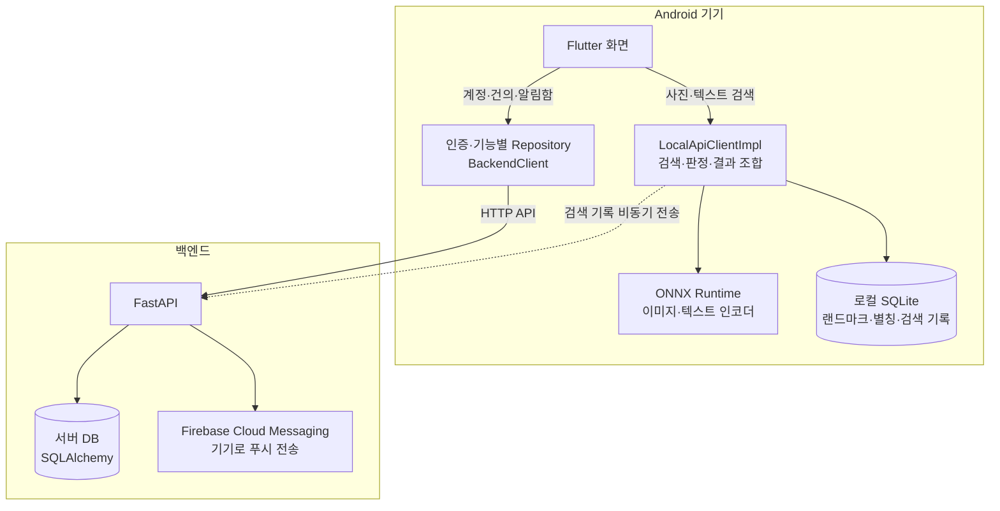

# Seoul Landmark Assistant

사진이나 텍스트로 서울의 랜드마크를 찾고, 다국어 설명을 확인하는 Flutter 앱입니다. MobileCLIP2 이미지·텍스트 인코더를 ONNX Runtime으로 기기 안에서 실행하며, 계정·건의·알림 기능은 FastAPI 백엔드와 연결합니다.

[모델 실험 저장소](https://github.com/HyunKN/ondevice-landmark-assistant) · [실험 결과](https://landmark-assistant-sprint1.vercel.app/experiments/paper/sprint2-main-matrix-results-2026-06-15.html) · [기술 문서](https://landmark-assistant-sprint1.vercel.app/) · [MIT License](LICENSE)

## 두 저장소의 역할

| 저장소 | 담당 범위 |
| --- | --- |
| **[lpcvc-2026-CNU/App](https://github.com/lpcvc-2026-CNU/App)** | 실제 앱 개발, 선정된 모델 연동, 사용자 기능, Android 빌드와 배포 |
| **[HyunKN/ondevice-landmark-assistant](https://github.com/HyunKN/ondevice-landmark-assistant)** | 모델 실험·비교·선정 근거, 학습·평가 코드, 모델과 앱의 연동 기록 |

모델 실험에서 결정한 ONNX 모델과 전처리·클래스·검색 정책을 App에 전달하고, App에서는 실제 입력부터 화면 표시까지의 동작을 검증합니다. 실험 정확도와 앱의 기기별 속도·안정성은 각각 확인해야 합니다.

## 주요 기능

| 기능 | 처리 위치와 동작 |
| --- | --- |
| 사진 검색 | 카메라·갤러리 이미지의 품질을 검사하고, 모델 임베딩과 랜드마크 대표 벡터를 비교해 상위 후보를 반환 |
| 텍스트 검색 | 텍스트 임베딩의 의미 유사도와 로컬 DB의 키워드 점수를 결합해 후보를 정렬 |
| 결과·상세 정보 | 후보, 유사도, 판정 상태를 표시하고 한국어·영어·중국어·일본어 설명과 상위 랜드마크 정보를 조회 |
| 계정 | 서버의 회원가입·로그인·탈퇴 API와 연결하고, 인증 토큰은 기기의 보안 저장소에 보관 |
| 건의·알림 | 사용자 건의, 관리자 승인·반려, 알림함, Firebase Cloud Messaging 연동 |
| 검색 기록 | 로컬 SQLite에 기록하고, 서버에도 비동기로 전송 시도 |

**검색 추론은 로컬에서 처리하지만 앱의 모든 기능이 오프라인인 것은 아닙니다.** 홈 화면은 로그인 상태에 따라 열리며, 최초 회원가입·로그인과 건의·알림 기능은 백엔드가 필요합니다. 검색 기록의 서버 전송 실패는 검색 결과 반환을 막지 않습니다.

## 아키텍처



[lib/main.dart](lib/main.dart)에서 DB, 추론 서비스, 검색 클라이언트, 인증 컨트롤러와 기능별 Repository를 연결합니다. [AuthGuard](lib/auth/auth_guard.dart)가 로그인 화면과 홈 화면을 선택합니다.

### 사진 검색: 입력 → 추론 → 후보 → 상세 화면

1. 사용자가 사진을 선택하면 [LocalApiClientImpl.search](lib/api/local_api_client_impl.dart)가 [ImageQualityService](lib/services/image_quality_service.dart)로 크기·밝기·대비·선명도를 확인합니다. 품질 기준을 통과하지 못하면 `low_quality`를 반환합니다.
2. [OnnxInferenceService](lib/services/onnx_inference_service.dart)가 RGB 변환, 크기 조정, 중앙 자르기, 정규화를 수행합니다. 현재 입력은 `[1, 3, 224, 224]` Float32이며, 이미지 인코더 출력은 L2 정규화한 512차원 벡터입니다.
3. `prototype_index.json`의 랜드마크 대표 벡터와 코사인 유사도를 계산해 상위 3개 후보를 선택합니다. 최고 점수와 1·2위 점수 차이를 `confidence_policy.json` 기준에 대조합니다.
4. 검색 메서드는 `top3`, `decision`, `reason_codes`, `latency_ms`를 담은 Dart Map을 반환합니다. [결과 화면](lib/ui/screens/result_screen.dart)은 이를 표시하고, [상세 화면](lib/ui/screens/detail_screen.dart)은 선택한 ID로 로컬 SQLite의 설명을 조회합니다.

### 텍스트 검색: 입력 → 의미·키워드 검색 → 결과 화면

1. [텍스트 검색 화면](lib/ui/screens/text_search_screen.dart)이 검색어를 전달하면 [KeywordSearchService](lib/services/keyword_search_service.dart)가 로컬 DB의 이름·별칭 등에서 키워드 점수를 구합니다.
2. [TokenizerService](lib/services/tokenizer_service.dart)가 검색어를 77개 토큰으로 변환하고, 텍스트 ONNX 인코더가 512차원 임베딩을 생성합니다.
3. [SemanticTextSearchService](lib/services/semantic_text_search_service.dart)가 `text_index.json`의 벡터와 비교하고, `text_search_policy.json`의 가중치로 의미 유사도와 키워드 점수를 결합합니다.
4. 랜드마크별 후보를 정렬하고 판정 상태를 반환합니다. 결과에는 의미 점수, 키워드 점수, 최종 점수와 일치한 텍스트도 포함됩니다.

| 판정 상태 | 의미 |
| --- | --- |
| `matched` | 설정한 점수·점수 차이 기준을 충족한 후보 |
| `ambiguous` | 후보 사이의 구분이 충분하지 않거나 점수가 불확실한 경우 |
| `out_of_scope` | 검색 정책상 적절한 후보를 제시하기 어려운 경우 |
| `low_quality` | 이미지 품질 검사에서 재촬영 등이 필요한 경우 |

표시 점수는 유사도 또는 결합 점수이며 **정답 확률이 아닙니다**. `out_of_scope` 판정이 실제 모든 미등록 장소의 거절 성능을 보장하지는 않습니다.

### 저장과 서버 연결

- **로컬 데이터:** [DatabaseHelper](lib/data/database_helper.dart)가 `assets/landmark_info.json`에서 다국어 랜드마크와 별칭을 초기 적재하고 검색 기록을 저장합니다.
- **모델 파일:** Android의 [MainActivity.kt](android/app/src/main/kotlin/com/example/landmark_demo_app/MainActivity.kt)가 `manifest.json`을 읽고 ONNX·외부 가중치 파일을 앱 내부 저장소에 복사합니다. Dart는 MethodChannel로 파일 경로를 받아 세션을 생성합니다.
- **인증:** [AuthController](lib/auth/auth_controller.dart)와 [TokenStorage](lib/auth/token_storage.dart)가 서버 인증과 토큰 보관·복원을 담당합니다.
- **백엔드:** [backend/app/main.py](backend/app/main.py)가 아래 라우터를 등록합니다. 서버 로그는 검색 결과 표시와 분리해 비동기로 전송합니다.

| API 경로 | 역할 |
| --- | --- |
| `/api/auth` | 회원가입·로그인·사용자 조회·탈퇴·FCM 토큰 갱신 |
| `/api/landmarks` | 서버의 랜드마크 목록 조회 |
| `/api/suggestions` | 건의 제출·조회와 관리자 상태 변경 |
| `/api/notifications` | 알림함 조회·읽음 처리·푸시 발송 |
| `/api/search/logs` | 검색 기록 수집 |

## 현재 연동 모델과 실험 근거

현재 [manifest.json](assets/mobile_artifacts_fp16/manifest.json)에 명시된 앱 연동 사양입니다.

| 항목 | 값 |
| --- | --- |
| 모델 | MobileCLIP2-S3 |
| 모델 ID | `mobileclip2_s3_server_full_ce_hardneg` |
| 구성 | 이미지·텍스트 인코더를 별도 ONNX 세션으로 로드 |
| 정밀도 정책 | FP16 혼합 저장, FP32 연산 (`selected_fp16_weight_storage_fp32_compute`) |
| 이미지 인식 클래스 | 23개 |
| 임베딩 차원 | 512 |
| 이미지 입력 / 텍스트 길이 | 224 × 224 / 77 tokens |
| ONNX opset | 18 |
| 앱 추론 경로 | ONNX Runtime 기본 CPU 경로 |

모델 이름만으로 연동 여부를 판단하지 않습니다. 전처리, 클래스 순서, 대표 벡터, tokenizer, 텍스트 인덱스와 판정 정책이 같은 모델 묶음에 대응해야 합니다. 필요한 파일은 [모델 파일 안내](assets/mobile_artifacts_fp16/README.txt)와 [검사 스크립트](scripts/check_model_contract.py)에서 확인할 수 있습니다.

- **[모델 실험·선정 저장소](https://github.com/HyunKN/ondevice-landmark-assistant):** 학습·평가·배포 실험의 전체 맥락
- **[Sprint 2 실험 비교 결과](https://landmark-assistant-sprint1.vercel.app/experiments/paper/sprint2-main-matrix-results-2026-06-15.html):** 후보 구성, 평가 기준과 결과
- **[모델 Serving Contract](https://landmark-assistant-sprint1.vercel.app/operations/model-serving-contract.html):** 모델 입출력, 전처리, 파일 구성과 연동 규칙
- **[Flutter 온디바이스 아키텍처 기록](https://landmark-assistant-sprint1.vercel.app/operations/flutter-ondevice-app-architecture.html):** 앱 연동 설계와 기술 기록

실험 결과는 해당 데이터셋과 평가 조건의 결과입니다. 이 README의 현재 모델 표는 App의 manifest를 기준으로 하며, 실험 순위와 앱에 실제 탑재한 모델은 구분해서 확인합니다.

## 코드 구조

```text
lib/
  main.dart            서비스 생성과 앱 진입점
  api/                 로컬 검색 조합, 서버 HTTP 통신, 다국어 문구
  services/            ONNX 추론, 이미지 품질, tokenizer, 검색, 푸시
  data/                SQLite와 기능별 Repository
  auth/                인증 상태, 화면 접근, 보안 토큰 저장
  ui/screens/          홈, 검색 결과, 상세, 계정, 건의, 알림, 관리자 화면
assets/
  mobile_artifacts_fp16/ 모델 메타데이터·인덱스 및 별도 제공받는 ONNX 파일
  landmark_info.json   랜드마크 설명과 별칭
  hero_images/         랜드마크 표시 이미지
android/               Android 빌드 설정과 모델 파일 준비 코드
backend/               FastAPI 라우터, 데이터 모델, 데이터 적재
scripts/               모델 연동 검사와 텍스트 검색 산출물 생성
test/                  점수 정책, tokenizer, 텍스트 인덱스 테스트
```

루트의 `pubspec.yaml`을 기준으로 앱을 실행합니다. `emulate/`에는 별도 Flutter 프로젝트가 있으므로 위 앱과 혼동하지 않도록 합니다.

## 개발 환경과 실행

### 1. 저장소와 도구 준비

Flutter SDK, Android SDK, JDK 17, Python을 준비합니다. 현재 Android 설정은 `compileSdk 35`, `NDK 27.0.12077973`이며, Dart SDK 범위는 [pubspec.yaml](pubspec.yaml)에 선언되어 있습니다. Flutter SDK의 정확한 버전은 저장소에 고정되어 있지 않습니다.

```powershell
git clone https://github.com/lpcvc-2026-CNU/App.git
cd App
flutter doctor
flutter pub get
```

### 2. 모델과 Firebase 설정 준비

`.onnx`와 `.onnx.data` 파일은 [.gitignore](.gitignore)에 의해 제외되어 있어 **clone만으로 모델이 준비되지는 않습니다**. 팀에서 제공하는 현재 manifest에 대응하는 모델 묶음을 받아 `assets/mobile_artifacts_fp16/`에 배치합니다. 이미지·텍스트 인코더 각각의 ONNX와 외부 가중치 파일이 모두 필요합니다. 이 README에는 아직 모델 묶음의 공개 다운로드 URL이 지정되어 있지 않습니다.

Android 빌드에는 프로젝트에 맞는 `android/app/google-services.json`도 준비합니다. 현재 application ID는 `com.example.landmark_demo_app`이며, Gradle에 Google Services 플러그인이 적용되어 있습니다. 런타임 Firebase 초기화 실패 시의 Mock 동작과 빌드 설정 파일 준비는 별개의 단계입니다.

실제 푸시 발송은 백엔드의 `backend/firebase-service-account.json`과 Firebase 설정이 필요합니다. 서버 서비스 계정 키는 비공개로 관리하고 Git에 커밋하지 않습니다. 백엔드에 이 파일이 없으면 실제 푸시 대신 Mock 로그를 사용합니다.

### 3. 백엔드 실행

아래는 **새 로컬 개발용 SQLite DB**를 사용하는 PowerShell 예시입니다. `migrate_landmarks.py`는 기존 랜드마크를 삭제하고 다시 적재하므로 기존 운영 DB에 실행하지 않습니다.

```powershell
cd backend
python -m venv .venv
.\.venv\Scripts\python.exe -m pip install -r requirements.txt
$env:DATABASE_URL = "sqlite:///./landmark-dev.db"
.\.venv\Scripts\python.exe migrate_landmarks.py
.\.venv\Scripts\python.exe -m uvicorn app.main:app --host 0.0.0.0 --port 8000 --reload
```

이 터미널을 유지하고 [로컬 API 문서](http://localhost:8000/docs)에서 서버를 확인합니다. 관리자 건의 처리는 서버에서 `is_admin` 권한이 부여된 계정이 필요합니다.

### 4. Android 앱 실행

새 터미널을 열고 **저장소 루트**에서 실행합니다.

Android 에뮬레이터:

```powershell
flutter run --dart-define=BACKEND_URL=http://10.0.2.2:8000
```

USB로 연결한 Android 실기기:

```powershell
adb reverse tcp:8000 tcp:8000
flutter run --dart-define=BACKEND_URL=http://localhost:8000
```

`adb`는 Android SDK의 `platform-tools`가 PATH에 등록되어 있어야 합니다. 서버 주소는 [BackendConfig](lib/api/backend_config.dart)의 `BACKEND_URL`로 주입합니다. 모델 준비와 세션 초기화가 완료된 뒤 회원가입·로그인, 사진 검색, 텍스트 검색, 상세 정보 표시를 확인합니다.

## 검증과 현재 제한

저장소 루트에서 실행하는 검사 명령입니다. 아래 명령의 존재는 최신 환경에서 통과했다는 의미가 아니며, 변경 후 직접 실행해 결과를 확인해야 합니다.

```powershell
flutter analyze
flutter test
python scripts/check_model_contract.py
python -m unittest discover -s scripts -p "test_model_integration_contract.py" -v
```

| 검사 | 확인하는 범위 |
| --- | --- |
| `flutter analyze` | Dart 정적 분석 |
| `flutter test` | 판정 정책, tokenizer fixture, 텍스트 인덱스 등 |
| `check_model_contract.py` | 필요한 모델 파일, 메타데이터, 클래스·인덱스·카탈로그 정합성 |
| `test_model_integration_contract.py` | 모델 묶음·스키마와 코드 연결에 대한 검사 |

Python 모델 검사는 별도로 받은 ONNX·외부 가중치 파일이 있어야 합니다. `test/widget_test.dart`는 현재 placeholder이므로 실제 화면 동작 검증으로 보지 않습니다. 위 검사는 Android에서의 모델 로딩·검색·메모리·지연 시간 측정을 대체하지 않습니다.

- **지원 범위:** 이미지 인식은 등록된 23개 클래스 기준입니다. 미등록 장소와 다양한 현장 조건에서의 성능은 별도 검증이 필요합니다.
- **플랫폼:** 이 실행 안내는 Android 기준입니다. iOS·웹·데스크톱 폴더의 존재가 동일한 모델 경로의 동작 검증을 뜻하지는 않습니다.
- **초기화:** 모델 파일 복사와 이미지·텍스트 세션 초기화가 필요합니다. 최초 실행 시간과 메모리는 기기에서 확인해야 합니다.
- **배포:** 현재 [Android release 설정](android/app/build.gradle.kts)은 debug 서명을 사용합니다. 정식 배포 전에 application ID, 배포 서명, 서버 주소와 모델 묶음 크기를 확인해야 합니다.
- **배포본 확인:** [GitHub Releases](https://github.com/lpcvc-2026-CNU/App/releases)에서 배포본을 확인할 수 있습니다. 2026-10-29 확인 기준으로 등록된 Release와 GitHub Actions workflow는 없습니다.

<a id="license"></a>

## 라이선스

프로젝트에서 작성한 소스 코드와 문서는 **[MIT License](LICENSE)**로 제공합니다. 외부 라이브러리, 사전학습 모델·가중치, 데이터셋과 이미지 등 제3자 자료는 각 원저작자의 라이선스와 이용 조건을 따릅니다.
